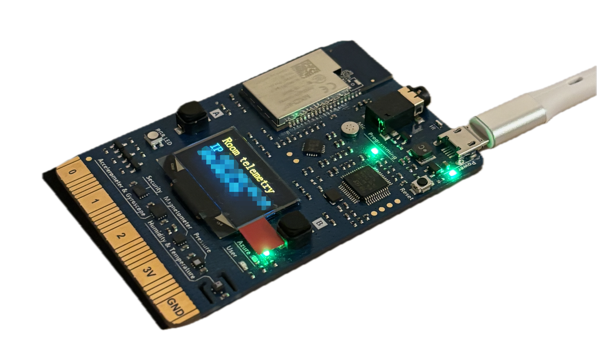

# Keeping an eye on my room

**MXChip room telemetry | Personal IoT project**

How hot does my room get during Paris's summer heatwaves? I wanted to keep an
eye on it while I was away at my internship. So I put an MXChip board in my room
and built the path from its sensors to a dashboard I could check remotely.

[Engineering log](SYSTEM_LOG.md) | [Setup](docs/setup.md) | [Deployment guide](infra/README.md)

*My board, also featured on my [profile](https://github.com/BshKatrin). Network details are blurred.*
<!-- Photo reused unchanged from BshKatrin/assets/projects/mxchip-blurred.png. -->

## From the room to the dashboard

The board sends temperature, humidity, and valid pressure readings over Wi-Fi.
FastAPI validates the JSON, InfluxDB stores the time series, and Grafana makes
the history readable. The backend runs together on one AWS EC2 instance with
Docker Compose; it doesn't need my laptop to stay online.

Nginx keeps the device's HTTP ingestion route and the browser's HTTPS dashboard
separate. Grafana requires login; the database and Grafana container ports stay
private. Certificates and renewal run on EC2 too. See the
[deployment configuration and renewal checks](infra/README.md).

## What it does

The system has been deployed on EC2 and checked with real device data. Here's
what it supports:

| Capability | Implemented behavior / evidence |
| --- | --- |
| Room monitoring | A reading after boot and Wi-Fi connection, then every **30 minutes**. [Firmware](mxchip/src/main.cpp) |
| Remote viewing | Temperature, humidity, and pressure panels; a default **24-hour** view and selectable history. [Dashboard](infra/grafana/provisioning/dashboards/mxchip-room.json) |
| Bounded history | **30 days** of raw readings and **1825 days** of daily summaries; older Grafana history uses daily means. [Retention](infra/influxdb/README.md) |
| Remote operation | Persistent volumes, restart policies, and certificate renewal checks **twice daily**. [Deployment checks](SYSTEM_LOG.md#2026-10-04---public-https-dashboard-and-automatic-renewal) |

Those are configuration values, not measured accuracy or uptime. The retention
policy does not mean five years of data have been collected.

Getting the whole chain to behave was the interesting part: fixing malformed
HTTP requests from the board SDK, omitting invalid pressure so it couldn't reject
useful samples, and correcting Grafana queries so older readings appeared at the
right timestamps. The [engineering log](SYSTEM_LOG.md) records the fixes and
end-to-end checks.

## Where the boundaries are

The deployed sensor path is **C/C++**; the repository also includes a Rust JSON
crate and UART input support. Delivery is best-effort: the retry queue is
volatile, and HTTP acceptance can still mean `stored=false`. Device ingestion
uses unauthenticated plain HTTP. See [implementation limits](docs/setup.md#known-limits)
before adapting it for other uses.

## Build on it

[Setup and API schema](docs/setup.md) | [Firmware](mxchip/README.md) |
[Backend](backend/README.md) | [Infrastructure](infra/README.md)

There is no separate report or slide deck; [SYSTEM_LOG.md](SYSTEM_LOG.md) is the
project's implementation and deployment record. The checks above describe that
record, not a fresh audit of the live instance.
